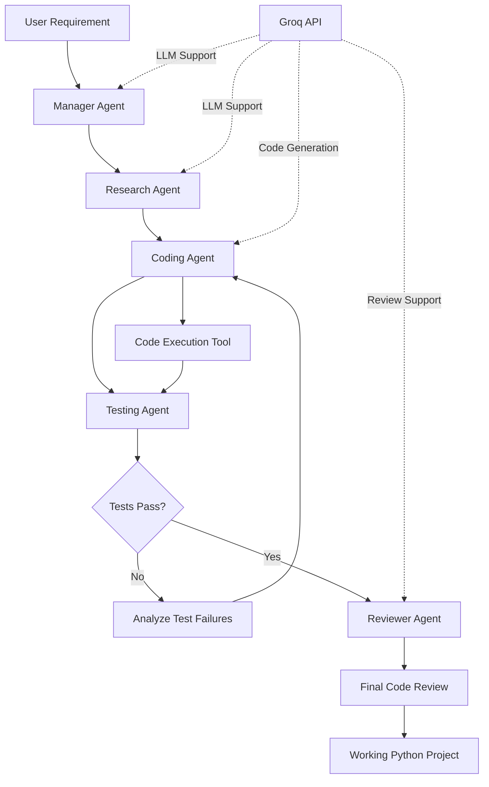

# CodeMind AI — Multi-Agent Coding Assistant

CodeMind AI is a multi-agent AI coding system that transforms a software requirement into a working Python project through a structured development workflow.

Instead of relying on a single AI agent, CodeMind AI uses specialized agents for planning, research, coding, testing, and code review.

## System Architecture



## Workflow

1. **User Requirement:** The user describes the software to build.
2. **Manager Agent:** Analyzes the requirement and creates a development plan.
3. **Research Agent:** Recommends technologies, project structure, implementation approach, and test cases.
4. **Coding Agent:** Generates Python project code based on the research plan.
5. **Testing Agent:** Executes the generated project and reports test results.
6. **Retry Workflow:** If testing fails, the Coding Agent receives the failure information and attempts to repair the code.
7. **Reviewer Agent:** Reviews the implementation and testing results.
8. **Final Output:** The system returns the generated project and review results.

## Key Features

- Multi-agent software development workflow
- Requirement analysis and project planning
- Technical research before implementation
- AI-based code generation
- Automated project execution and testing
- Failure-aware coding retry workflow
- Final AI code review
- LangGraph-based workflow orchestration
- Groq-powered LLM agents
- Python code validation
- Modular agent architecture

## Agents

### Manager Agent

Analyzes the user's requirement and creates a development plan.

### Research Agent

Recommends technologies, project structure, implementation approach, edge cases, and testing requirements.

### Coding Agent

Generates the project code based on the research plan.

If testing fails, the Coding Agent receives the previous code and test result and attempts to repair the implementation.

### Testing Agent

Executes the generated project using the project execution tool and reports whether the application passes or fails.

### Reviewer Agent

Reviews the generated implementation together with the test result and produces the final quality assessment.

## Technology Stack

- Python
- LangGraph
- Groq API
- LLM-based Agents
- AST-based Python Validation
- Streamlit
- Git and GitHub

## Project Structure

```text
CodeMind_AI/
├── agents/
│   ├── manager_agent.py
│   ├── research_agent.py
│   ├── coding_agent.py
│   ├── testing_agent.py
│   └── reviewer_agent.py
├── tools/
│   ├── code_executor.py
│   └── project_parser.py
├── tests/
├── app.py
├── graph.py
├── llm_test.py
├── requirements.txt
├── .env
└── README.md
```

Do not commit your actual `.env` file or virtual environment to GitHub.

## How It Works

A requirement is provided to CodeMind AI.

Example:

```text
Create a Python calculator application.
```

The Manager Agent creates the development plan. The Research Agent develops technical recommendations, and the Coding Agent generates the application.

The Testing Agent executes the generated project and validates the result. If the project fails, the workflow can return to the Coding Agent with the previous implementation and failure information.

If testing passes, the Reviewer Agent evaluates the implementation and produces the final review.

## Example Result

For a Python calculator requirement, CodeMind AI generated a calculator supporting:

- Addition
- Subtraction
- Multiplication
- Division
- Power
- Percentage
- Square root
- CLI usage
- Optional GUI

The generated project was successfully executed and received:

```text
TEST RESULT: PASS
RETRY COUNT: 1
REVIEW STATUS: APPROVED
```

## Installation

### 1. Clone the Repository

```bash
git clone https://github.com/diva-hug/CodeMind_AI.git
cd CodeMind_AI
```

### 2. Create a Virtual Environment

```bash
python -m venv venv
```

### 3. Activate the Environment on Windows

```powershell
venv\Scripts\activate
```

### 4. Install Dependencies

```bash
pip install -r requirements.txt
```

### 5. Configure the API Key

Create a `.env` file in the project root:

```env
GROQ_API_KEY=your_groq_api_key
```

Keep your API key private and make sure `.env` is included in `.gitignore`.

## Running CodeMind AI

### Run the LangGraph Workflow

```powershell
venv\Scripts\python.exe graph.py
```

### Run the Streamlit Application

```powershell
venv\Scripts\python.exe -m streamlit run app.py
```

## Project Goal

The goal of CodeMind AI is to demonstrate how multiple specialized AI agents can collaborate to automate a software development workflow rather than relying on a single LLM response for code generation.

The architecture can be extended with additional agents for debugging, documentation, security analysis, deployment, and performance optimization.

## Future Improvements

- Automatic GitHub repository generation
- Automated pull request creation
- Support for more programming languages
- Security review agent
- Documentation agent
- Deployment agent
- Persistent project memory
- Advanced test generation
- Code quality and performance analysis

## Author

**Divakar Putta**

Built as a practical AI Engineering and Multi-Agent Systems project.
